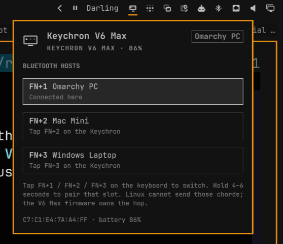

# OmaKeytron



Omarchy bar plugin for a **Keychron V6 Max**. Plugin id `wizwam.omakeytron`.

It names the three Bluetooth hosts and shows whether this PC currently has
the keyboard.

| Chord | Default host |
| --- | --- |
| FN+1 | Omarchy PC (this machine) |
| FN+2 | Mac Mini |
| FN+3 | Windows Laptop |

Switching is firmware on the keyboard. Tap FN+1/2/3 to hop; hold 4–6 seconds
to pair that slot. Slide the side switch to Bluetooth first. An Omarchy
plugin cannot send those chords — Linux never sees them.

What this plugin does:

- Bar chip: connected here vs away
- OSD when the V6 Max joins or leaves this PC
- Panel with the three named hosts and pairing reminder
- Right-click the chip (or the FN+1 row) to ask BlueZ to reconnect this slot

## Install

```bash
omarchy plugin add https://github.com/lukejmorrison/omakeytron.git --enable
```

From a checkout:

```bash
./scripts/install-local.sh --section right
```

Place the chip:

```bash
omarchy bar move wizwam.omakeytron --section right --before omarchy.tray
```

## Use

- Left-click: open the host map
- Right-click: `omarchy bluetooth device connect` for this Keychron
- Middle-click: copy the Bluetooth address
- Click FN+2 / FN+3 in the panel: OSD reminder to tap that chord
- Settings: rename the three hosts, pin a MAC, pick which FN slot is this PC

## Verify

```bash
./scripts/test.sh
omarchy plugin list | awk '$1 == "wizwam.omakeytron"'
python3 status.py --match "Keychron V6 Max"
omarchy-shell wizwam.omakeytron status
```

## Remove

```bash
omarchy plugin disable wizwam.omakeytron
omarchy plugin remove wizwam.omakeytron --yes
```

## License

MIT. See [LICENSE](LICENSE).
